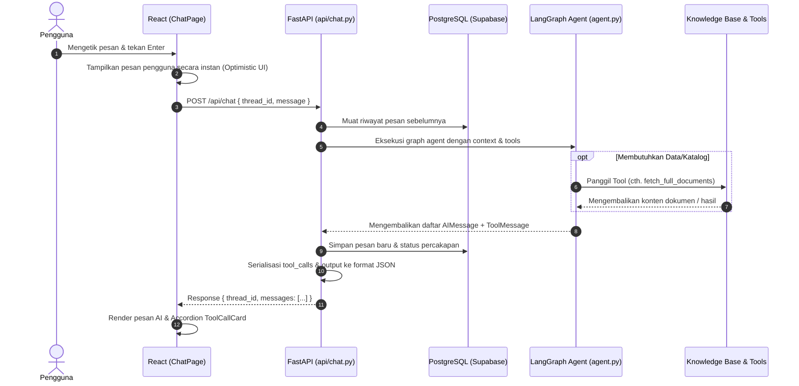

# ⚡ Pertamina AI Chatbot — Frontend Documentation

Frontend antarmuka pengguna (UI) modern berbasis **React 19 + Vite** untuk Pertamina Procurement Chatbot. Mengusung gaya antarmuka **ChatGPT-like** dengan tema visual **Dark Blue** (`#0a1628`) dan aksen putih/biru muda Pertamina (`#4a90d9` & `#ffffff`), dilengkapi pemantauan **Tool Calls AI secara visual (accordion)**, manajemen riwayat chat persisten di PostgreSQL/Supabase, serta form generator terintegrasi (RKS, Dokumen Tender, dan Amandemen).

---

## 📑 Daftar Isi
1. [Tech Stack & Dependensi](#-tech-stack--dependensi)
2. [Struktur Direktori](#-struktur-direktori)
3. [Keterangan Masing-Masing Komponen](#-keterangan-masing-masing-komponen)
   - [Aplikasi & Layout Utama](#1-aplikasi--layout-utama)
   - [Sidebar & Riwayat Percakapan](#2-sidebar--riwayat-percakapan)
   - [Modul Percakapan (Chat)](#3-modul-percakapan-chat)
   - [Visualisasi Tool Call (ToolCallCard)](#4-visualisasi-tool-call-toolcallcard)
   - [Halaman Generator Dokumen](#5-halaman-generator-dokumen)
4. [Mekanisme Integrasi dengan Backend](#-mekanisme-integrasi-dengan-backend)
   - [Reverse Proxy Vite](#1-reverse-proxy-vite-viteconfigjs)
   - [Klien Layanan API (Axios)](#2-klien-layanan-api-srcservicesapijs)
   - [Daftar Endpoint FastAPI yang Digunakan](#3-daftar-endpoint-fastapi-yang-digunakan)
   - [Alur Siklus Percakapan & Tool Calls](#4-alur-siklus-percakapan--tool-calls)
   - [Persistensi Riwayat Percakapan](#5-persistensi-riwayat-percakapan)
5. [Panduan Menjalankan & Build](#-panduan-menjalankan--build)

---

## 🛠 Tech Stack & Dependensi

- **Core**: [React 19](https://react.dev/) + [Vite 8](https://vitejs.dev/) (Fast HMR & lightweight bundling)
- **Routing**: [React Router DOM v7](https://reactrouter.com/) (Single Page Application navigation)
- **HTTP Client**: [Axios](https://axios-http.com/) (Request & response handling dengan timeout dan multipart support)
- **Icons**: [Lucide React](https://lucide.dev/) (Icon pack konsisten dan ringan)
- **Markdown & Code Rendering**: [React Markdown](https://github.com/remarkjs/react-markdown) + [Remark GFM](https://github.com/remarkjs/remark-gfm) (Mendukung tabel Markdown, tasklist, strikethrough, formatting klausul hukum)
- **Utility**: [UUID](https://github.com/uuidjs/uuid) (Client-side unique key generation)

---

## 📁 Struktur Direktori

```text
Frontend/frontend/
├── public/                     # Aset statis publik (favicon, icons)
├── src/
│   ├── assets/                 # Aset grafis & logo
│   ├── components/             # Komponen UI modular
│   │   ├── chat/
│   │   │   ├── ChatInput.jsx       # Input teks textarea dengan auto-grow
│   │   │   ├── ChatInput.css
│   │   │   ├── ChatMessage.jsx     # Bubble chat + subkomponen ToolCallCard
│   │   │   ├── ChatMessage.css
│   │   │   ├── MessageList.jsx     # Kontainer daftar pesan & empty state
│   │   │   └── MessageList.css
│   │   └── sidebar/
│   │       ├── Sidebar.jsx         # Sidebar navigasi & list riwayat chat
│   │       └── Sidebar.css
│   ├── pages/                  # Halaman aplikasi (Full Page Takeover)
│   │   ├── ChatPage.jsx            # Tampilan utama percakapan AI
│   │   ├── ChatPage.css
│   │   ├── TenderPage.jsx          # Wizard pembuatan Dokumen Tender
│   │   ├── RKSPage.jsx             # Form pembuatan dokumen RKS
│   │   ├── AmandemenPage.jsx       # Form penyusunan Amandemen Kontrak
│   │   └── FormPage.css            # Styling bersama untuk semua form generator
│   ├── services/
│   │   └── api.js                  # Definisi service API (Chat, Tender, RKS, Health)
│   ├── App.jsx                 # Routing, layout shell, dan state manajemen thread
│   ├── App.css
│   ├── index.css               # Tema warna dark-blue, tipografi Inter, dan CSS reset
│   └── main.jsx                # Entry point React DOM
├── package.json
└── vite.config.js              # Konfigurasi Vite & dev server proxy (/api -> 8000)
```

---

## 🧩 Keterangan Masing-Masing Komponen

### 1. Aplikasi & Layout Utama
- **`src/App.jsx`**:
  - Berfungsi sebagai orchestrator utama aplikasi.
  - Membungkus seluruh aplikasi dengan `<BrowserRouter>` dan mendefinisikan rute:
    - `/` → `ChatPage`
    - `/generate-tender` → `TenderPage`
    - `/generate-rks` → `RKSPage`
    - `/generate-amandemen` → `AmandemenPage`
  - Mengelola state global riwayat percakapan:
    - `threads`: Daftar riwayat sesi dari database.
    - `activeThreadId`: ID sesi chat yang sedang aktif.
    - `sidebarCollapsed`: Status minimize sidebar.
  - Menyediakan handler CRUD untuk thread: membuat sesi baru (`handleNewChat`), memilih thread (`handleSelectThread`), mengganti judul thread (`handleRenameThread`), dan menghapus thread (`handleDeleteThread`).
- **`src/index.css`**:
  - Menyimpan palet CSS variables bertema Dark Blue:
    - `--bg-primary: #0a1628` (Latar belakang utama)
    - `--bg-secondary: #0d1f3c` (Latar belakang sidebar)
    - `--bg-card: #112240` (Kartu dan bubble pesan AI)
    - `--accent-blue: #4a90d9` (Tombol aktif & border sorotan)
    - `--text-primary: #e8f0fe` & `--text-secondary: #94afd4`
  - Menyediakan styling tipografi untuk rendering Markdown (tabel peraturan, blok kode, kutipan regulasi).

---

### 2. Sidebar & Riwayat Percakapan
- **`src/components/sidebar/Sidebar.jsx` & `Sidebar.css`**:
  - **Brand Header**: Logo petir Pertamina AI dan tombol collapse sidebar.
  - **Tombol Percakapan Baru (`+`)**: Mengosongkan thread aktif untuk memulai konteks obrolan baru.
  - **Menu Navigasi Cepat**:
    - *Generate RKS* (`/generate-rks`)
    - *Generate Tender* (`/generate-tender`)
    - *Generate Amandemen* (`/generate-amandemen`)
  - **Riwayat Percakapan (Thread List)**:
    - Menampilkan riwayat percakapan yang diambil dari database PostgreSQL.
    - **Inline Rename**: Pengguna dapat mengklik ikon pensil untuk langsung mengedit judul sesi percakapan.
    - **Delete Thread**: Pengguna dapat menghapus sesi percakapan melalui ikon tempat sampah.
    - **Collapsible Mode**: Sidebar dapat diperkecil menjadi mode ikon saja untuk memperluas area kerja layar.

---

### 3. Modul Percakapan (Chat)
- **`src/pages/ChatPage.jsx` & `ChatPage.css`**:
  - Bertanggung jawab memuat pesan dari thread yang dipilih (`chatService.getMessages`).
  - Mengimplementasikan **Optimistic UI**: Ketika pengguna mengirim pesan, teks langsung ditampilkan di antarmuka sebelum request backend selesai.
  - Mengirim pesan ke endpoint backend `POST /api/chat` dan mengupdate pesan AI beserta daftar *tool calls*.
- **`src/components/chat/MessageList.jsx` & `MessageList.css`**:
  - Kontainer vertikal yang menampilkan deretan bubble pesan.
  - Menggunakan `useRef` dan `scrollIntoView` agar chat otomatis scroll ke bagian paling bawah setiap ada pesan baru atau indikator loading.
  - **Empty State**: Ketika belum ada pesan, menampilkan salam sambutan, icon AI, dan 4 saran pertanyaan pengadaan (suggestion chips) yang dapat diklik langsung.
- **`src/components/chat/ChatInput.jsx` & `ChatInput.css`**:
  - Textarea input responsif dengan auto-grow (ketinggian membesar otomatis sesuai panjang teks hingga maksimal 180px).
  - Shortcut keyboard: **Enter** untuk mengirim pesan, **Shift + Enter** untuk baris baru.
  - Tombol kirim otomatis beranimasi aktif saat ada teks yang diketik.
- **`src/components/chat/ChatMessage.jsx` & `ChatMessage.css`**:
  - Menampilkan bubble chat terpisah untuk pengguna (rata kanan, latar biru) dan AI (rata kiri, kartu gelap dengan ikon bot).
  - Merender konten AI menggunakan `react-markdown` dan `remark-gfm` sehingga format tabel spesifikasi pengadaan, penomoran pasal, dan tautan dokumen tampil rapi.
  - Memiliki subkomponen **`TypingIndicator`** dengan animasi 3 titik berdenyut saat agen AI sedang memproses jawaban.

---

### 4. Visualisasi Tool Call (`ToolCallCard`)
Terletak di dalam `src/components/chat/ChatMessage.jsx`:
- **Latar Belakang**: Agen LangGraph di backend menggunakan berbagai alat kerja (*tools*) seperti pencarian dokumen internal, kalkulasi HPS, pembuatan RKS, dan pencarian web.
- **Tampilan Interaktif**:
  - Jika pesan AI memicu pemanggilan tool, kartu **accordion** akan muncul tepat di atas jawaban teks AI.
  - Memetakan nama teknis tool ke label bahasa Indonesia yang ramah pengguna:
    - `search_tool` → 🌐 Pencarian Internet
    - `fetch_full_documents` → 📄 Ambil Dokumen Lengkap
    - `fetch_relevant_documents` → 📄 Ambil Dokumen Relevan
    - `create_rks_document` → 📄 Buat Dokumen RKS
    - `convert_pdf_to_docx` → 📄 Konversi ke DOCX
    - `generate_amendment_document` → 🔧 Buat Dokumen Amandemen
  - Indikator status visual:
    - ⏳ *Running* (animasi berdenyut)
    - ✅ *Done* (hijau)
    - ❌ *Error* (merah)
  - Pengguna dapat mengklik kartu untuk melihat **Input** (parameter yang dikirim agen) dan **Output** (data dokumen/hasil yang diperoleh agen) dalam format kode monospaced yang rapi.

---

### 5. Halaman Generator Dokumen

- **`src/pages/TenderPage.jsx` (Generate Dokumen Tender)**:
  - Mengadopsi alur **3-Step Wizard**:
    1. **Langkah 1 (Upload Dokumen)**: Pengguna mengunggah berkas RKS (PDF/Word), BOQ (Excel/PDF), dan Dokumen Pendukung Pemilihan Pengadaan (DP3) lainnya (bisa berupa folder, kumpulan berkas PDF/DOCX/Excel/TXT, atau arsip ZIP). Sistem memanggil `POST /api/tender/extract-context` untuk mengekstraksi judul proyek, risiko CSMS, nilai HPS, rincian BOQ, serta poin penting DP3 secara otomatis melalui AI.
    2. **Langkah 2 (Form Pengisian & Review DP3)**: Seluruh formulir terisi otomatis. Konteks DP3 yang diekstrak AI ditampilkan dalam kartu interaktif collapsible `<details>` dengan daftar berkas terproses, pemberitahuan berkas yang dilewati, ringkasan poin teknis/kualifikasi yang dapat diedit, serta tombol untuk menghapus/menonaktifkan konteks DP3.
    3. **Langkah 3 (Unduh Dokumen)**: Menampilkan status keberhasilan pembuatan dokumen, nama berkas yang dihasilkan, dan tombol langsung untuk mengunduh berkas Microsoft Word (`.docx`).
- **`src/pages/RKSPage.jsx` (Generate Dokumen RKS)**:
  - Form pembuatan draf Rencana Kerja & Syarat-Syarat berdasarkan deskripsi kebutuhan pengadaan dari pengguna.
  - Menyediakan opsi ID dokumen sumber untuk referensi spesifik dari katalog.
  - Memanggil `POST /api/rks/generate` dan menyediakan kartu unduh berkas DOCX resmi.
- **`src/pages/AmandemenPage.jsx` (Generate Dokumen Amandemen)**:
  - Form terstruktur untuk menyusun dokumen amandemen kontrak berdasarkan Nomor Kontrak asal, Nomor Amandemen, Tanggal, dan Perubahan Lingkup Pekerjaan.
  - Terintegrasi langsung dengan asisten AI di backend.

---

## 🔌 Mekanisme Integrasi dengan Backend

Integrasi antara frontend React dan backend FastAPI dilakukan melalui RESTful API dengan format payload JSON dan Multipart Form-Data.

### 1. Reverse Proxy Vite (`vite.config.js`)
Agar frontend dapat berkomunikasi dengan backend FastAPI tanpa mengalami kendala CORS (*Cross-Origin Resource Sharing*) pada lingkungan pengembangan, Vite dikonfigurasi dengan reverse proxy:

```javascript
// vite.config.js
export default defineConfig({
  plugins: [react()],
  server: {
    proxy: {
      '/api': {
        target: 'http://127.0.0.1:8000',
        changeOrigin: true,
      },
    },
  },
})
```
Setiap request dari React yang mengarah ke path `/api/*` secara otomatis diteruskan ke server FastAPI di port `8000`.

---

### 2. Klien Layanan API (`src/services/api.js`)
Instansiasi Axios dikonfigurasi dengan `baseURL: '/api'` dan batas waktu request `120000ms` (2 menit) untuk mengakomodasi proses inferensi LLM dan rendering dokumen Word:

```javascript
const api = axios.create({
  baseURL: '/api',
  timeout: 120000,
})
```

Modul ini mengekspos 3 layanan utama:
- **`chatService`**: Manajemen percakapan dan thread.
- **`tenderService`**: Ekstraksi berkas RKS/BOQ dan kompilasi dokumen tender.
- **`rksService`**: Pembuatan draf RKS dan daftar katalog.

---

### 3. Daftar Endpoint FastAPI yang Digunakan

| Modul | Method | URL Path | Content-Type | Keterangan |
|---|---|---|---|---|
| **Chat** | `POST` | `/api/chat` | `application/json` | Mengirim pesan ke LangGraph Agent & menerima respon lengkap + tool calls |
| **Chat** | `GET` | `/api/chat/threads` | `application/json` | Mengambil seluruh riwayat sesi percakapan |
| **Chat** | `POST` | `/api/chat/threads` | `application/json` | Membuat sesi percakapan baru |
| **Chat** | `GET` | `/api/chat/threads/{id}/messages` | `application/json` | Mengambil riwayat pesan satu sesi |
| **Chat** | `DELETE` | `/api/chat/threads/{id}` | `application/json` | Menghapus sesi percakapan |
| **Chat** | `PATCH` | `/api/chat/threads/{id}` | `application/json` | Mengubah judul sesi percakapan |
| **Tender** | `POST` | `/api/tender/extract-context` | `multipart/form-data` | Mengekstraksi metadata pengadaan dari berkas RKS dan BOQ |
| **Tender** | `POST` | `/api/tender/generate` | `application/json` | Menghasilkan Dokumen Tender resmi format DOCX |
| **Tender** | `GET` | `/api/tender/download/{filename}` | Binary Stream | Mengunduh berkas DOCX yang telah dibuat |
| **RKS** | `POST` | `/api/rks/generate` | `application/json` | Membuat draf RKS baru dari knowledge base |
| **RKS** | `GET` | `/api/rks/download/{filename}` | Binary Stream | Mengunduh dokumen RKS format DOCX |
| **Health** | `GET` | `/api/health` | `application/json` | Healthcheck konektivitas API backend |

---

### 4. Alur Siklus Percakapan & Tool Calls



#### Struktur Data Pesan yang Diterima Frontend:
```json
{
  "thread_id": "89ba4bfb-9a04-46c5-929c-d09a041f9a6c",
  "messages": [
    {
      "role": "human",
      "content": "Berapa lama masa sanggah untuk tender konstruksi?",
      "tool_calls": []
    },
    {
      "role": "ai",
      "content": "Berdasarkan Pedoman Pengadaan Pertamina...",
      "tool_calls": [
        {
          "id": "call_abc123",
          "name": "fetch_relevant_documents",
          "input": { "query": "masa sanggah tender konstruksi" },
          "output": "Pasal 42: Masa sanggah pengadaan konstruksi adalah 3 hari kerja...",
          "status": "done"
        }
      ]
    }
  ]
}
```

---

### 5. Persistensi Riwayat Percakapan
Semua sesi dan percakapan disimpan secara terpusat di **PostgreSQL / Supabase** melalui modul `rag/conversation_store.py` di backend:
- Tabel `chat_threads`: Menyimpan metadata sesi (`id`, `owner_token`, `title`, `updated_at`).
- Tabel `chat_messages`: Menyimpan seluruh daftar pesan (`position`, payload `JSONB` dari pesan LangChain).
- Hal ini memastikan riwayat chat tidak hilang meskipun halaman di-refresh atau diakses dari perangkat berbeda.

---

## 🚀 Panduan Menjalankan & Build

### 1. Prasyarat
- **Node.js**: Versi `18.0.0` atau yang lebih baru.
- **NPM**: Versi `9.0.0` atau yang lebih baru.
- **Backend FastAPI**: Harus sudah aktif di `http://127.0.0.1:8000`.

### 2. Menjalankan Backend FastAPI (Terminal 1)
```powershell
cd "d:\Coding practice\Pertamina\Pertamina_Chatbot"
uv run python -m api.main
```

### 3. Menjalankan Frontend Development Server (Terminal 2)
```powershell
cd "d:\Coding practice\Pertamina\Pertamina_Chatbot\Frontend\frontend"

# Install dependensi (jika baru pertama kali)
npm install

# Jalankan server development Vite
npm run dev
```
Aplikasi akan aktif di alamat default: **`http://localhost:5174/`** (atau `5173`).

### 4. Build untuk Lingkungan Produksi
Untuk mengompilasi bundel statis HTML, JS, dan CSS yang teroptimasi:
```powershell
npm run build
```
Hasil build akan berada di direktori `Frontend/frontend/dist/` dan siap disajikan menggunakan web server statis (Nginx, Caddy, atau disajikan langsung via FastAPI StaticFiles).
